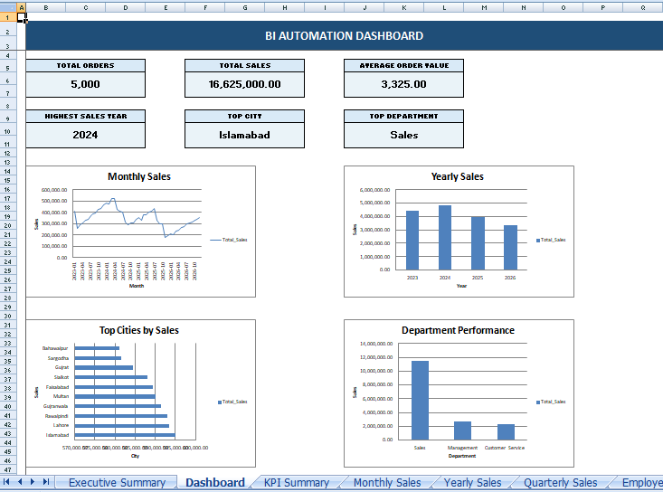
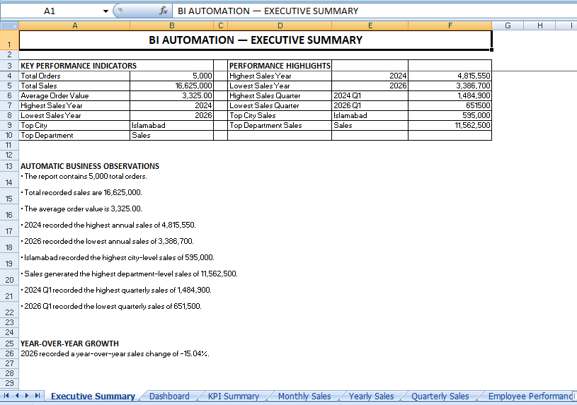
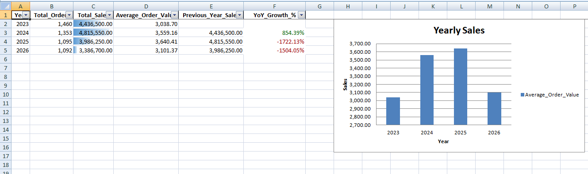
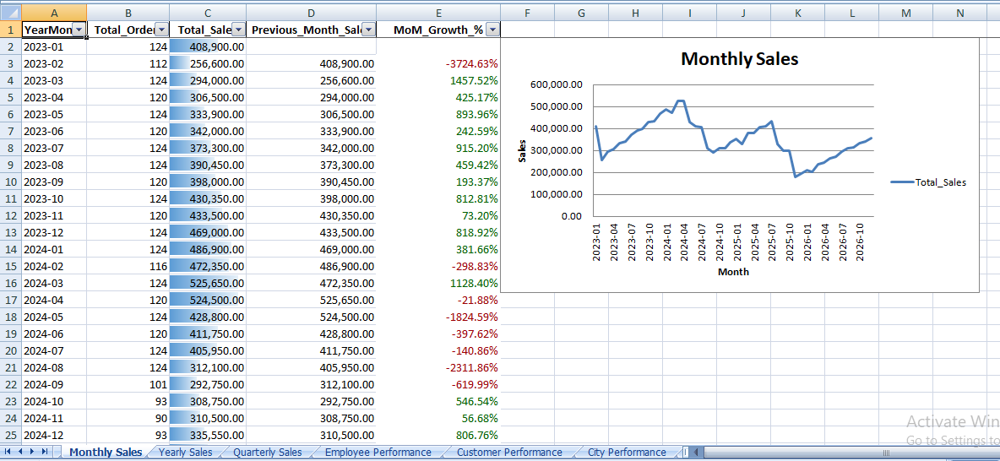
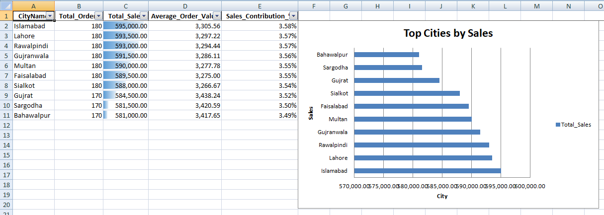
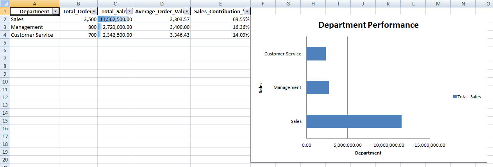

<div align="center">

# BI Automation & Reporting Pipeline

### SQL Server · Python · Pandas · Excel Reporting

An end-to-end Business Intelligence automation project that extracts
retail data from SQL Server, validates records, calculates business
KPIs, analyses sales performance, and generates a professional
timestamped Excel report.

<br>


<br>

**Developed by Anas Islam**

[GitHub](https://github.com/AnasDev23) ·
[LinkedIn](https://www.linkedin.com/in/anas-islam-it)

</div>

---

## Project Overview

The BI Automation & Reporting Pipeline is a Python-based Business
Intelligence solution designed to automate retail sales analysis and
Excel report generation.

It connects to a Microsoft SQL Server database, retrieves sales and
related business records, validates the extracted information, performs
analytical calculations, and produces one consolidated Excel workbook.

The final workbook includes an executive summary, a KPI dashboard,
sales performance analysis, customer and employee insights, charts,
and data-quality information.

The reporting workflow is automated: each successful execution creates
a new timestamped Excel report.

## Key Features

### 1. SQL Server Data Extraction

- Connects to Microsoft SQL Server.
- Uses SQL joins to combine orders, customers, cities, and employees.
- Retrieves structured retail sales data for analysis.
- Uses environment-based database configuration.

### 2. Data Validation and Preparation

- Checks missing values.
- Identifies invalid sales values.
- Validates order dates.
- Identifies negative sales records.
- Converts date and numerical columns into suitable data types.

### 3. Business Intelligence KPIs

The application calculates:

- Total orders
- Total sales
- Average order value
- Minimum and maximum order value
- Unique customers
- Unique employees
- Unique cities
- Unique departments

### 4. Sales and Performance Analysis

- Monthly sales analysis
- Month-over-month sales growth
- Yearly sales analysis
- Year-over-year sales growth
- Quarterly sales analysis
- Employee performance
- Customer performance
- City performance
- Department performance
- City and department comparison
- Customer and city sales contribution
- Top 10 customers and cities
- Sales distribution statistics

### 5. Automated Excel Reporting

The application creates one timestamped Excel workbook containing:

- Professional KPI dashboard
- Executive summary
- Business observations
- Monthly, quarterly, and yearly analysis
- Customer, employee, city, and department performance
- Top-performing customers and cities
- Excel charts
- Conditional formatting
- Data-quality summary
- Missing-value analysis

## Screenshots

The following screenshots demonstrate the generated report and
application execution.

### 1. Executive Dashboard



### 2. Executive Summary



### 3. Yearly Sales



### 3. Monthly Sales



### Top Cities by Sales



### Department Performance




## Project Architecture

```text
Microsoft SQL Server
        |
        v
SQL Query and Data Extraction
        |
        v
SQLAlchemy + PyODBC
        |
        v
Pandas Data Processing
        |
        v
Data Validation and Preparation
        |
        v
Business Intelligence Calculations
        |
        v
KPI and Performance Analysis
        |
        v
Excel Workbook Generation
        |
        v
OpenPyXL Formatting and Charts
        |
        v
Timestamped Automated Report